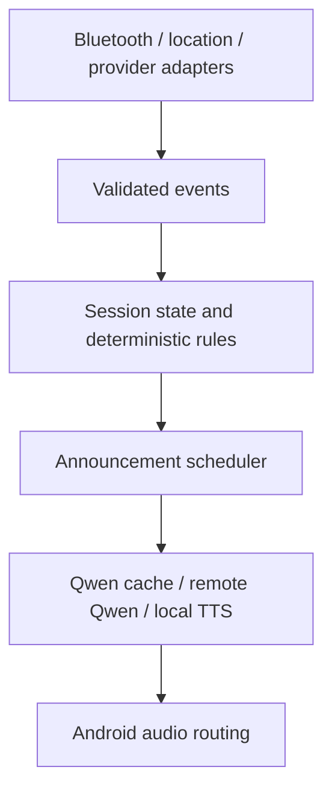

# Architecture and functional increments

## Current boundary

Phase 1 provides a native app with real vehicle/session/history functionality and a separately testable pure session engine. It uses the prepared project-local toolchain. Actual Pixel 8/car behavior remains a verification gate; an APK build does not establish background Bluetooth reliability.

## Initial code structure

The implementation uses two modules:

```text
android/
  app/                    Native Android adapters and minimum useful vehicle/session UI
    vehicle/              Selected-car storage, association, Bluetooth events
    drive/                Foreground service and lifecycle reconciliation
    diagnostics/          Test-only actions and observable session events
  core/drive/             Pure Kotlin session state machine and deterministic timing rules
```

`core/drive` must not import Android APIs. Test connection identity, duplicate events, disconnect grace, reconnect cancellation, and state restoration with a controllable clock. Device association and process recovery require Android integration/device tests in addition to those unit tests.

`DriveCoordinator` serializes initialization, callbacks, history choices, and expiry through one mutex. A single Room checkpoint transaction stores the complete immutable snapshot, so history reassignment cannot publish a partially moved period. Snapshot schema changes use serialization defaults; the Room schema is checked in. No destructive database migration or silent history reset is configured.

Android adapters use public Bluetooth/companion APIs, reject BLE proximity as connection evidence, and query both audio profiles only for bounded reconciliation. Exact events invalidate older asynchronous snapshots. Broadcast completion remains held through database initialization, observation registration/profile checks, and any foreground-service request.

The service enters foreground before slow work. During grace only, a timeout-bounded partial wake lock supervises the original 20-second deadline and final bounded connection check. No wake lock or Bluetooth scanning loop runs throughout ordinary driving. Popup focus does not own the timer; the notification uses the platform chronometer. Unexpected teardown suspends known state rather than continuing an open history interval in Standby.

Recovery is deliberately conservative: an unseen process-death/reboot gap is not assumed to be connected driving. It can close an old period at the last verified observation and create a new period when fresh evidence arrives. Duration/history is therefore not a certified trip recorder.

Keep future places, location, speed, voice, navigation, UI, database, and settings in clear packages. Extract additional Gradle modules only when ownership, reuse, platform isolation, or build performance warrants it. Do not create empty modules for the entire roadmap now.

## Event flow



Persist selected-car identity and enough state for lifecycle reconciliation. A restored state is not proof that the car is still connected: reconcile with supported platform observations before resuming resources or speech.

Suggested session states: NOT_CONFIGURED, CAR_DISCONNECTED, CAR_CONNECTING, DRIVE_STARTING, DRIVE_ACTIVE, TEMPORARILY_DISCONNECTED, DRIVE_ENDING. Avoid duplicate services, greetings, location subscriptions, and session-end timers.

Separate the active driving period from its persistent history grouping. A short grace reconnect stays in the same period. After grace expiry, resuming a history record adds a new connected period and preserves the disconnected gap. History-selection state does not itself authorize Bluetooth/service startup. See [the detailed session design](bluetooth-session-design.md).

## Implementation order

| Increment | Real result | Required dependencies |
| --- | --- | --- |
| F1: car/session core | Real car selection, automatic activation, grace/reconnect/end, visibility-aware disconnect countdown, local history, and app/notification Resume/New choices | Project toolchain; Android Bluetooth/companion/notification permissions; storage; Pixel 8/car |
| F2: audible welcome and optional session commands | Local-time greeting, priority queue, local TTS; optional bounded voice Resume/New with explicit fallback | F1; audio focus/routing; separately verified speech recognizer and microphone eligibility |
| F3: saved destinations | Real search, map choice, persisted place/radius/messages, Waze departure | Storage; selected map/search services; F2 for speech |
| F4: arrivals | Validated arrival announcement with anti-repeat state | F1 session gating; F2 speech; F3 coordinates; location/geofences |
| F5: speed awareness | Quality-controlled GPS speed, matched road limit, deterministic escalating warnings | F1; F2; location; licensed/accessible road provider |
| F6: Qwen voice | Original voice, generated audio, cache, secure backend, local fallback | F2 speech contract; suitable backend hardware; endpoint |
| F7: release hardening | Measured background/audio/battery/UI behaviour and acceptance evidence | All implemented increments |

Investigate provider access/coverage and Qwen hardware early. They should not block implementing F1 or local speech. Qwen backend work can proceed separately after the voice API contract is agreed. Full UI navigation grows as its real features become available; no four-tab blank dashboard first.

## Planned integration contracts

- `PlaceSearchProvider`: normalized search results with usable coordinates and explicit errors; independent of map renderer.
- `SpeedLimitProvider` -> `SpeedLimitResolver` -> `SpeedWarningEngine`: limit/source/segment/confidence/freshness, explicit unknown state, deterministic warning decisions.
- `AnnouncementManager`: bounded queue, message identity, expiration, priority, cancellation, and audio-focus handling; safety announcements cannot depend on remote synthesis.
- `QwenTtsClient`: bounded request timeouts, authenticated endpoint, model/profile/style identifiers, audio format, safe retry semantics. Agree the contract before installing a backend stack.

## Initial build choices

JDK 21, Gradle 8.13, AGP 8.13.2, Kotlin/Compose plugin 2.2.21, Android platform/target 36, minimum API 31, build tools 35.0.0. App identity: `io.github.enan511.drivingcompanion`. Compose BOM 2025.10.01, Room 2.8.4/KSP, and all other dependency versions are explicit in the catalog. These are a pinned compatible baseline, not a claim to be the newest versions. Verify the actual phone OS and API paths on-device.

Sources checked during preparation: [AGP compatibility](https://developer.android.com/build/releases/agp-8-13-0-release-notes), [Gradle Java compatibility](https://docs.gradle.org/current/userguide/compatibility.html), [Android SDK manager](https://developer.android.com/tools/sdkmanager).
