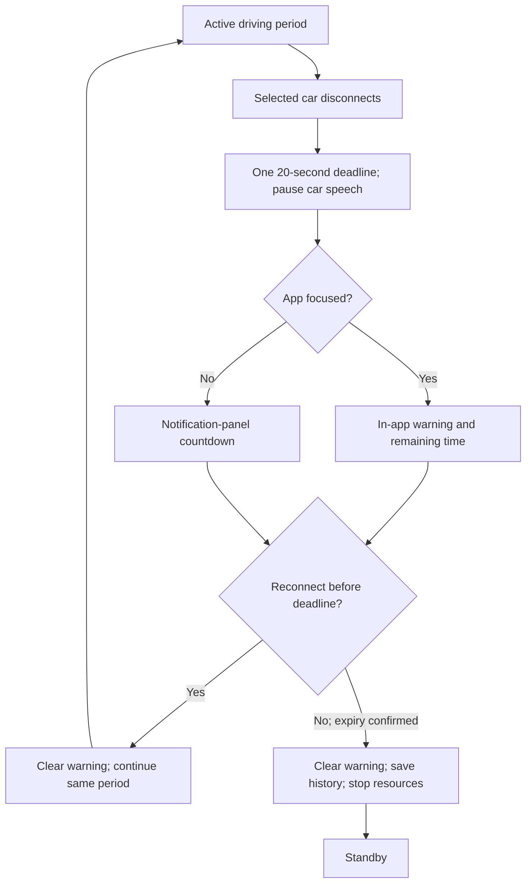
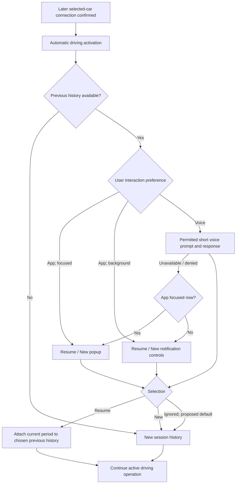

# Bluetooth, disconnect warnings, and session history

Design update following the user's 17 October 2026 suggestions. This is a proposal and requirements record; no feature code or APK exists.

## Disconnect behaviour

Keep the existing approximately 20-second grace period. A single persisted deadline controls both presentations; neither screen changes nor notification dismissal restart it.

| Situation | Presentation and lifecycle |
| --- | --- |
| Selected car disconnects with app focused | Show an in-app warning: "Car disconnected. Waiting to reconnect: 00:20." The ordinary Android service notification may still exist, but do not duplicate the warning as a heads-up alert. |
| App is backgrounded or screen locked | Show the same countdown in the notification panel; no overlay, full-screen intent, forced activity launch, or heads-up interruption requested by the app. |
| Visibility changes during grace | Move the warning presentation to the appropriate surface with the original remaining time. |
| Car reconnects before expiry | Remove the warning, cancel expiry, continue the same driving period, and avoid duplicate start/greeting. |
| Deadline expires and car is still disconnected | Remove the warning, close/save the driving period, stop active resources/service, and return to standby. The saved history remains. |
| Notifications are denied/disabled | Do not claim the background warning is visible. Explain missing access in setup; still apply the same lifecycle deadline and show accurate state when the UI returns. |

Pause car-directed speech immediately when the route is lost. The countdown is a connection-wait deadline, not a demand for the user to manually repair Bluetooth before a penalty. The app cannot force Android/the car to reconnect.

Android provides a notification chronometer countdown. Prefer system-rendered time over reposting a notification each second. The session deadline remains authoritative, independent of notification rendering. On process recreation, reconcile current connection and deadline before showing a warning or reviving resources. Expiry and reconnect races must be handled by one serialized state owner.

## History and resuming

One history record can contain several connected driving periods. Reconnecting within grace continues the current period. Reconnecting after it has ended creates a new period that can belong to a new or resumed history record. Disconnected time is not counted as driving.

Store local history identity, vehicle reference, start/end/last-active timestamps, each period's start/end and end reason, and relevant feature context when those features exist. History survives ordinary process/app restarts. Avoid collecting full GPS route traces merely to implement history. Keep runtime history and private device data out of the public Git repository. A Git checkout on another PC carries development progress, not phone history.

History selection cannot by itself start monitoring while the selected car is disconnected. It may prepare a preferred history record for the next validated connection. Restoring history must not restore stale GPS speed, legal-limit guesses, warning stages, or expired queued announcements. Destination context can be restored when destinations exist; launching Waze still follows its deliberate navigation action.

Suggested UI location: Home -> Session history, a secondary screen rather than a fifth main tab.

## Resume/New presentation

User-selected interaction preference:

- App popup: when the app is focused, offer Resume previous / New session. When backgrounded, expose appropriate notification actions or a user-tapped route into that choice; never open a popup over Waze.
- Voice: when the car audio path and permitted speech interaction are available, offer a short Resume/New prompt and accept a bounded response. Microphone permission, background-start rules, calls, recognition errors, and no response need clear fallback to app/notification controls. This does not imply always-on wake-word listening.

Voice recognition is separate from Qwen3-TTS. It will be researched and verified with the voice increment; no unimplemented voice setting should masquerade as working functionality.

Proposed default, awaiting confirmation: connection still starts driving operation automatically with a new history record. Resume/New chooses how to group its history; it does not become a required Start Drive button. If ignored, the new history record remains. Choosing Resume attaches the current period to the selected previous record atomically, without restarting services, losing already captured current-period data, or replaying greetings. A repeated or expired selection cannot reattach the period twice.

## Implementation and verification

F1 implements persistent session/period rules, selected-car callbacks, grace handling, foreground/background warning surfaces, local history, and app/notification selections. F2 adds actual speech and optional speech-recognition commands after platform eligibility is verified.

Test one deadline across screen changes, expiry cleanup, denied notifications, manual notification dismissal, duplicate callbacks, simultaneous reconnect/expiry, process recreation, history persistence, disconnected resume attempts, current-period reassignment, and speech fallback. Native Bluetooth, background notification rendering, microphone eligibility, and car audio need real-device evidence.

Platform references: [Android countdown notifications](https://developer.android.com/reference/android/app/Notification.Builder#setChronometerCountDown(boolean)), [notification navigation](https://developer.android.com/develop/ui/views/notifications/navigation), [microphone service restrictions](https://developer.android.com/develop/background-work/services/fgs/service-types#microphone).
